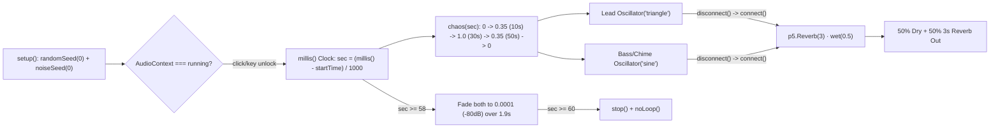

# ICM Week 11 — Essential Mechanisms, Philosophy & Critique Q&A

**Sketches:**
- Iteration 1 (*Lydian bus*): https://editor.p5js.org/monadlnomad/sketches/wVJAtbxKP (`47` lines)
- Iteration 2 (*Bolder fig*): https://editor.p5js.org/monadlnomad/sketches/w9vW455uc (`73` lines)
- Final (*Darkened brass*): https://editor.p5js.org/monadlnomad/sketches/W7y7amaHg (`106` lines)

---

## 1. Signal & Logic Architecture



### 1-Bit Markov Anti-Pause State Machine

```mermaid
stateDiagram-v2
  [*] --> NOTE
  NOTE --> NOTE : "p = 0.78 (play note)"
  NOTE --> REST : "p = 0.22 (!wasRest)"
  REST --> NOTE : "p = 1.00 (forced note next)"
```

---

## 2. Philosophy & 5 Core Mechanisms

| Pillar | Artistic Idea ("Philosophy") | Exact Code Mechanism |
|---|---|---|
| **Shaped Entropy** | Pure `random()` has zero memory, so after ~10s nothing feels surprising. Blending smooth `noise()` into `random()` builds expectation before breaking it. | `if (random(1) < chaos) r = random(ratios); else r = ratios[floor(noise(t) * ratios.length)];` |
| **Deterministic Indeterminacy** | Like John Cage's chance scores, randomness designs the piece at composition time, then seeds freeze it for repeatable 2x class playback. | `randomSeed(0); noiseSeed(0);` |
| **Harmonic Safety Net** | Just-intonation major pentatonic ratios omit the semitone and tritone, so overlapping reverb tails never clash harshly. | `ratios = [1, 1.125, 1.25, 1.5, 1.67, 2]; BASE = 261.63;` |
| **Wall-Clock Precision** | Frame counting (`3600` frames) runs too fast on 144Hz+ screens (`~45s`). Wall-clock `millis()` locks duration to `60.0s` everywhere. | `sec = (millis() - startTime) / 1000;` |
| **Anti-Pause & DSP** | 1-bit rest guard caps silences under `0.4s`; `disconnect()` prevents doubled dry audio; `0.0001` avoids `log10(0) = -Infinity`. | `if (!wasRest && random(1) < 0.22)` / `osc.disconnect(); osc.connect(reverb);` |

---

## 3. Essential Code Constants

| Value | Meaning & Purpose |
|---|---|
| `261.63` | Middle C (`C4`) base frequency (`0.5x = 130.8 Hz`, `2x = 523.3 Hz`) |
| `0.0001` | `-80 dB` silent floor so `p5.sound` (`20 * log10(amp)`) never hits `-Infinity` |
| `0.36 -> 0.14` | Lead step duration (seconds) interpolated by `chaos`, plus `random(-0.05, 0.06) * chaos` shift |
| `chaos > 0.65` | Climax window (`~18.6s–41.4s`) enabling `35%` chance for Voice 2 to jump `2x` high chimes |
| `p5.Reverb(3)` + `0.5` | 3-second reverb tail blended `50%` dry / `50%` wet |

---

## 4. 10 Critique Questions & Short Spoken Answers

1. **Why randomness, and why both `noise()` and `random()`?**  
   Iteration 1 used pure `random()`, which has no memory and gets repetitive after 10s. Perlin `noise()` steps smoothly like a tune. Blending them across a 60s `chaos` curve gives the piece a clear intro, climax, and calm ending.
2. **How do we know both playbacks in class will sound identical?**  
   `randomSeed(0)` and `noiseSeed(0)` freeze the exact random stream. Every time you press Play, the exact same 60-second composition plays.
3. **Why use those specific decimal ratios (`1, 1.125, 1.25, ...`)?**  
   Those are just-intonation pentatonic intervals above Middle C (`261.63 Hz`). Because there are no half-steps or tritones, random notes overlapping in reverb always stay musical.
4. **How do you guarantee it lasts 60 seconds?**  
   Originally I counted frames, which finishes early on 144Hz monitors. Switching to `millis()` locks the fade-out at `58s` and stop at `60.0s` on any computer.
5. **How did you stop random rests from leaving awkward long pauses?**  
   A `wasRest` boolean forces the next step after any rest to play a note (`P(REST | REST) = 0`), keeping every pause under `0.4s`.
6. **Why fade to `0.0001` instead of `0`?**  
   `p5.sound` converts amplitude using `log10(amp)`, and `log10(0)` is `-Infinity`. `0.0001` is `-80 dB` (silent and mathematically safe).
7. **Why call `osc.disconnect()` before `osc.connect(reverb)`?**  
   New oscillators connect to the speakers automatically. Disconnecting first prevents doubling the dry signal so `reverb.wet(0.5)` controls the clean 50/50 blend.
8. **Why do the high chime notes only happen in the middle?**  
   Voice 2 normally plays low bass (`0.5x`), and only gets a `35%` chance to jump up (`2x`) when `chaos > 0.65` (`~18.6s–41.4s`).
9. **Why is the canvas blank white?**  
   The assignment says *"No visuals. Just sound."* So `setup()` draws a blank white canvas and `draw()` waits until `getAudioContext().state === 'running'`.
10. **What changed across your 3 iterations while working solo?**  
    With my partner gone, I kept the scope focused (~106 lines): Iter 1 tested raw `random()`, Iter 2 added `noise()` + chaos arc + rests, and Final added `triangle` vs. `sine` contrast, timing shifts, high chimes, and `p5.Reverb`.
